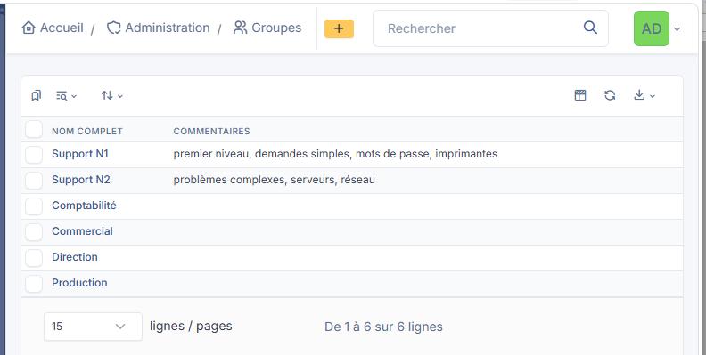
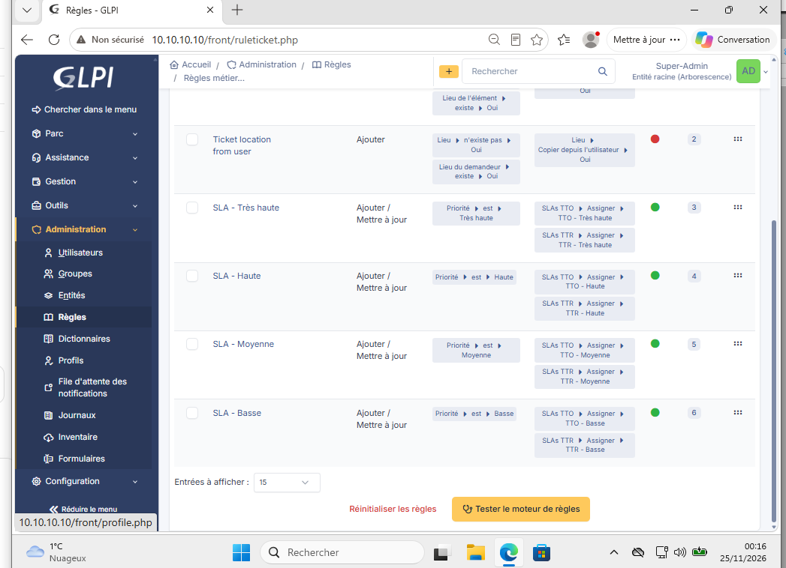
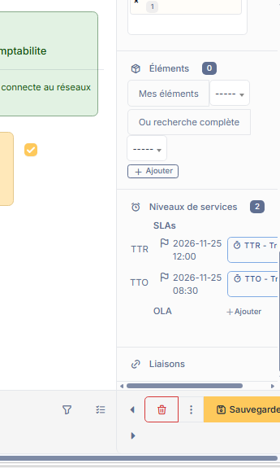
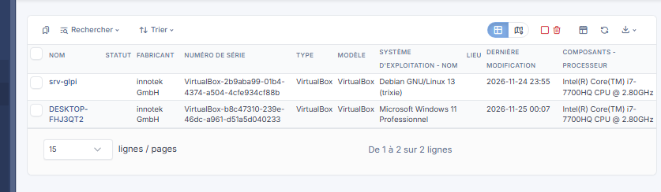
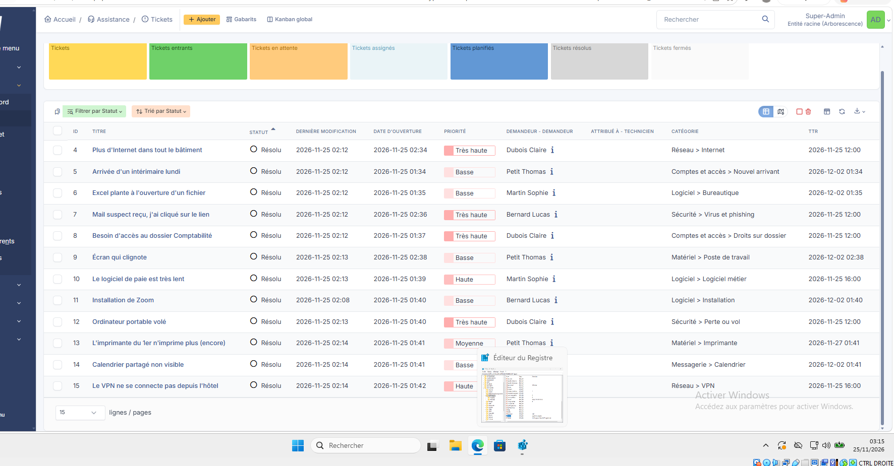
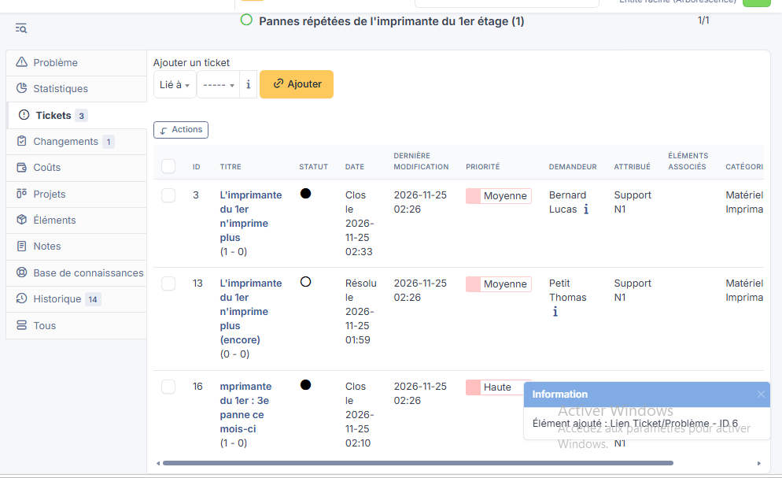
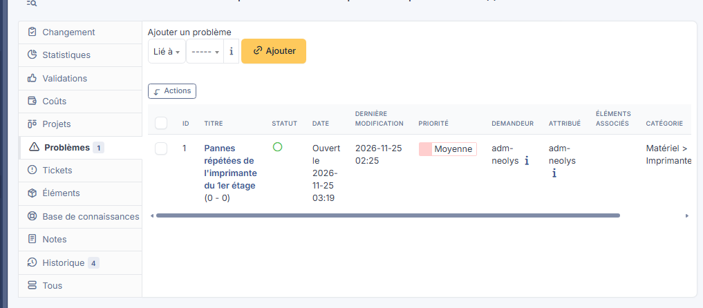
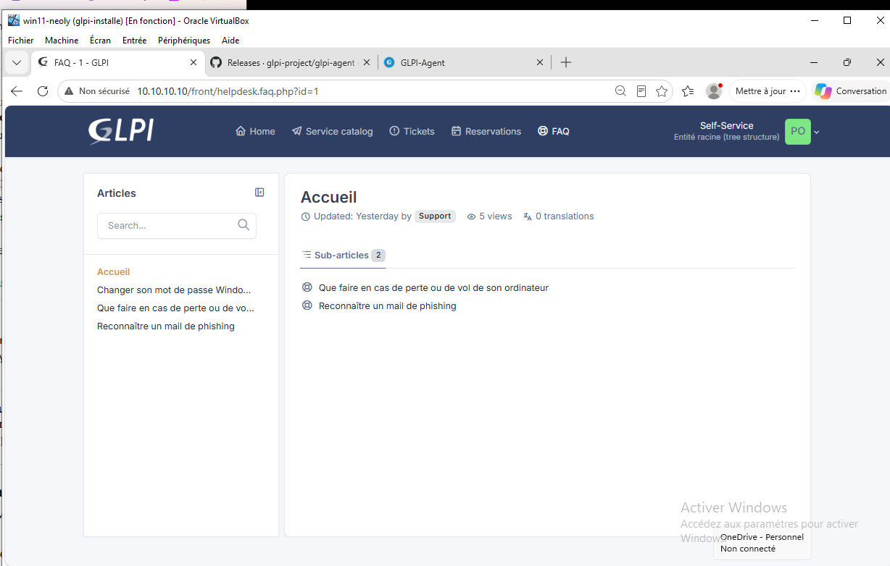

# Lab Néolys – Projet 2 : support utilisateurs avec ITIL et GLPI

Projet 2 de mon parcours autodidacte **Administrateur systèmes, réseaux et cybersécurité**, construit sur le [lab du projet 1](https://github.com/) (pare-feu OPNsense, LAN et DMZ).

## Contexte

Chez Néolys (PME fictive de 45 salariés), les demandes arrivaient par mail, par téléphone et dans le couloir. Rien n'était tracé, des demandes se perdaient, et la direction ne savait pas combien de temps l'informatique consacrait au support.

**Mission** : mettre en place un service de support structuré selon les bonnes pratiques **ITIL**, avec un outil de tickets et d'inventaire, des niveaux de service mesurables, et une base de connaissances.

## Résultat en un coup d'œil

| Élément | Réalisé |
|---|---|
| Serveur GLPI 12.0.2 (Debian 13, Apache, PHP 8.4, MariaDB) | ✅ IP fixe 10.10.10.10, dans le LAN |
| Sécurisation | ✅ Comptes par défaut désactivés, compte admin nominatif, fichier d'installation supprimé, cookies HttpOnly, compte SQL dédié |
| Organisation du service | ✅ 6 catégories et 17 sous-catégories, groupes Support N1 et N2, 4 services utilisateurs |
| Priorités et SLA | ✅ Matrice urgence × impact, 8 SLA (TTO et TTR), calendrier des heures ouvrées, règles d'attribution automatique |
| Inventaire automatique | ✅ GLPI Agent sur Windows 11 et Debian, avec authentification |
| Traitement des tickets | ✅ 15 tickets réalistes (incidents, demandes, sécurité) |
| Gestion des problèmes et des changements | ✅ 1 problème lié à 3 incidents, 1 changement avec analyse d'impact, plan de retour arrière et validation |
| Base de connaissances | ✅ 4 articles, dont 3 en FAQ pour les utilisateurs |

## Architecture

```
                 Internet
                    │
            ┌───────┴────────┐
            │  fw-neolys     │  OPNsense (projet 1)
            └───────┬────────┘
                    │ LAN 10.10.10.0/24
     ┌──────────────┼──────────────────┐
     │              │                  │
 srv-glpi        win11-neoly        srv-lan
 10.10.10.10     poste client       serveur
 GLPI 12         + GLPI Agent       + GLPI Agent
 + GLPI Agent
```

## Documentation

- [Procédure d'installation de GLPI](docs/procedure-installation.md)
- [Processus du support : cycle de vie d'un ticket, priorités et SLA](docs/processus-support.md)
- [Les 15 tickets traités, avec le corrigé](docs/15-tickets.md)
- [Base de connaissances : les 4 articles](docs/base-de-connaissances.md)
- [Journal de dépannage](docs/journal-depannage.md)

## Ce que montre ce projet

### 1. Un service organisé
Les tickets sont classés par **catégorie**, attribués au bon **niveau de support** (N1 pour les demandes simples, N2 pour le réseau, les serveurs et la sécurité) et rattachés au **service** du demandeur, ce qui permet des statistiques par service.



### 2. Des engagements de service mesurables
La **priorité** se calcule automatiquement (urgence × impact), et une **règle métier** applique le bon SLA. Les délais ne comptent que pendant les **heures ouvrées** (du lundi au vendredi, de 8 h à 18 h).

| Priorité | Prise en charge (TTO) | Résolution (TTR) |
|---|---|---|
| Très haute | 30 min | 4 h |
| Haute | 1 h | 8 h |
| Moyenne | 4 h | 2 jours |
| Basse | 8 h | 5 jours |



Test : un ticket de priorité Très haute créé à 00 h 14 obtient une prise en charge à 08 h 30 et une résolution à 12 h 00, soit 30 minutes et 4 heures **ouvrées**.



### 3. Un inventaire automatique
L'agent GLPI remonte le matériel, le système et les logiciels sans aucune saisie manuelle. L'inventaire exige une **authentification**, pour empêcher l'envoi de faux inventaires.



### 4. Le traitement de vrais cas
15 tickets : mot de passe, imprimante, panne Internet générale, arrivée d'un intérimaire, **phishing**, **vol d'ordinateur portable**, demande d'accès qui exige une validation…



### 5. La logique ITIL : incident, problème, changement
L'imprimante du 1er étage est tombée en panne 3 fois : chaque incident est réparé vite (solution de contournement), puis un **problème** cherche la cause racine (un pilote incompatible), et un **changement** déploie la solution définitive de façon contrôlée (analyse d'impact, plan de retour arrière, validation).




### 6. Une base de connaissances avec des droits
Les articles destinés aux utilisateurs apparaissent dans la FAQ du Self-Service. La procédure technique (redémarrage du spouleur) n'est visible que par le support.



## Compétences mises en œuvre

ITIL (incident, demande, problème, changement) · GLPI · SLA et matrice de priorité · Inventaire et gestion de parc · Administration Linux (Apache, PHP, MariaDB, NetworkManager) · Sécurisation d'une application web · Rédaction de procédures et de documentation utilisateur · Support N1 et N2

## Prochaine étape

Projet 3 : concevoir le réseau du siège et de l'agence.
